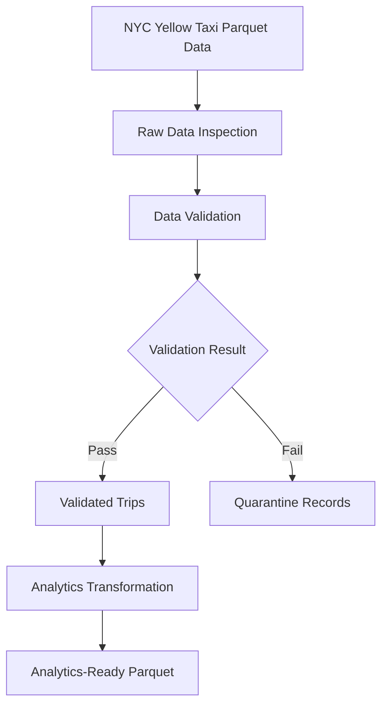

# UberPulse — End-to-End Ride Analytics Lakehouse

> An end-to-end data engineering project that transforms NYC Yellow Taxi data into validated, analytics-ready datasets, with a roadmap toward an Azure Lakehouse.


## Project Overview

UberPulse is a data engineering portfolio project built around NYC Yellow Taxi trip records. The current local pipeline inspects source data, validates records, quarantines invalid trips, and creates analytics-ready features.

The long-term goal is to evolve the project into an Azure Lakehouse using Azure Data Factory, Azure Data Lake Storage Gen2, Azure Databricks, Delta Lake, Unity Catalog, and secure credential management.

**Current status:** The local Python pipeline is implemented. Azure deployment is planned and has not yet been completed.

## Architecture



## Verified Results

| Metric | Result |
|---|---:|
| Source records | 3,475,226 |
| Source columns | 20 |
| Validated records | 3,473,175 |
| Quarantined records | 2,051 |
| Record reconciliation | Passed |
| Automated tests | 25 passed |

These results reflect a previous successful local run. Runtime and performance may vary by machine.

## Pipeline Workflow

1. **Inspect:** Examine the source schema, data types, missing values, and anomalies.
2. **Validate:** Apply explicit hard-failure rules.
3. **Quarantine:** Preserve records that fail hard validation, including their failure reasons.
4. **Transform:** Create analytics-ready data with derived trip and time features.
5. **Test:** Verify validation, transformation, and pipeline behavior.
6. **Reconcile:** Confirm that valid and quarantined records account for all input records.

## Data Quality

### Hard validation failures

Records are quarantined when they have:
- Missing pickup or drop-off timestamps
- Non-positive trip duration
- Negative trip distance
- Missing fare or total amount

### Warning conditions

Warnings are recorded without automatically quarantining a trip:
- Zero trip distance
- Negative fare or total amount
- Fare above $500
- Trip distance above 100 miles
- Trip duration above 24 hours

Negative fares and totals are not automatically discarded because unusual financial records may represent adjustments or reversals requiring further investigation.

## Technology Stack

| Technology | Purpose |
|---|---|
| Python | Pipeline scripts and orchestration |
| pandas | Data validation and transformation |
| PyArrow / Parquet | Columnar data storage |
| pytest | Automated tests |
| Git | Version control |

### Planned Azure Architecture

| Service | Intended role |
|---|---|
| Azure Data Factory | Pipeline orchestration |
| Azure Data Lake Storage Gen2 | Cloud data storage |
| Azure Databricks / Apache Spark | Scalable processing |
| Delta Lake | Lakehouse tables |
| Unity Catalog | Data governance and access control |
| Azure Key Vault and managed identity | Secure access to secrets and resources |
| Monitoring and retry handling | Operational reliability |

These Azure services are planned components, not an existing deployment.

## Repository Structure

```text
UberPulse/
├── data/
│   ├── raw/                 # Local source data; excluded from Git
│   └── processed/           # Generated outputs; excluded from Git
├── docs/
│   ├── data_quality_findings.md
│   └── data_quality_rules.md
├── src/
│   ├── ingestion/
│   │   └── inspect_raw_data.py
│   ├── validation/
│   │   └── validate_trips.py
│   ├── transformation/
│   │   └── transform_trips.py
│   └── pipeline/
│       └── run_pipeline.py
├── tests/
├── requirements.txt
└── README.md
```

## Dataset

This project uses the NYC Taxi & Limousine Commission Yellow Taxi Trip Records.

Official source: https://www.nyc.gov/site/tlc/about/tlc-trip-record-data.page

Current local input file:

`data/raw/yellow_tripdata_2025-01.parquet`

Download the January 2025 Parquet file from the official source and place it at the path above before running the pipeline. The dataset is excluded from Git.

## Getting Started

### Prerequisites

- Python 3.11
- pip
- The January 2025 Yellow Taxi Parquet file at the path documented above

### 1. Create a virtual environment

```powershell
py -3.11 -m venv .venv
.\.venv\Scripts\Activate.ps1
```

### 2. Install dependencies

```powershell
python -m pip install -r requirements.txt
```

### 3. Run the pipeline

```powershell
python .\src\pipeline\run_pipeline.py
```

### 4. Run the tests

```powershell
python -m pytest -q
```

## Generated Outputs

The pipeline generates these local Parquet files under `data/processed/`:

- `yellow_tripdata_2025-01_valid.parquet` — records passing hard validation
- `yellow_tripdata_2025-01_quarantine.parquet` — records failing hard validation, with failure reasons
- `yellow_tripdata_2025-01_analytics.parquet` — analytics-ready records with derived features

Generated data is excluded from Git to keep the repository manageable.

## Demo and Evidence

This section will be expanded with real pipeline execution screenshots, test results, data-quality summaries, and example analytics as those assets are captured and verified.

## Roadmap

- [x] Implement local inspection, validation, and transformation
- [x] Separate invalid records into a quarantine dataset
- [x] Add automated tests and record reconciliation
- [x] Pin dependencies and configure Git hygiene
- [ ] Add richer pipeline metrics and sample outputs
- [ ] Capture real execution and testing demonstrations
- [ ] Build the Azure-based Lakehouse pipeline
- [ ] Add orchestration, monitoring, retries, and failure handling
- [ ] Add analytics queries and business-focused insights
- [ ] Explore demand forecasting after the core data engineering pipeline is complete

## Engineering Principles

- Make data-quality rules explicit and testable.
- Preserve invalid records for investigation rather than silently dropping them.
- Separate hard validation failures from warnings.
- Keep secrets and large generated datasets out of source control.
- Distinguish implemented functionality from planned architecture.

## Verified Pipeline Run

The following results were captured from an actual successful local execution of the pipeline.

| Metric | Result |
|---|---:|
| Input records inspected | 3,475,226 |
| Valid records | 3,473,175 |
| Quarantined records | 2,051 |
| Analytics output records | 3,473,175 |
| Analytics output columns | 34 |
| Record reconciliation | Passed |
| Pipeline runtime | 16.01 seconds |

The record counts reconcile exactly:

`3,473,175 valid + 2,051 quarantined = 3,475,226 input records`

The measured runtime reflects this specific local run and hardware; it is not a cloud performance benchmark.

### Validation and transformation evidence

- The validation step completed and wrote the valid and quarantine datasets.
- The analytics transformation preserved the valid record count.
- Record reconciliation and basic transformation checks passed.
- The pipeline completed all three steps successfully.

The local execution log is stored at `logs/pipeline_demo.log` on the development machine. It is excluded from Git along with the raw and generated datasets.
